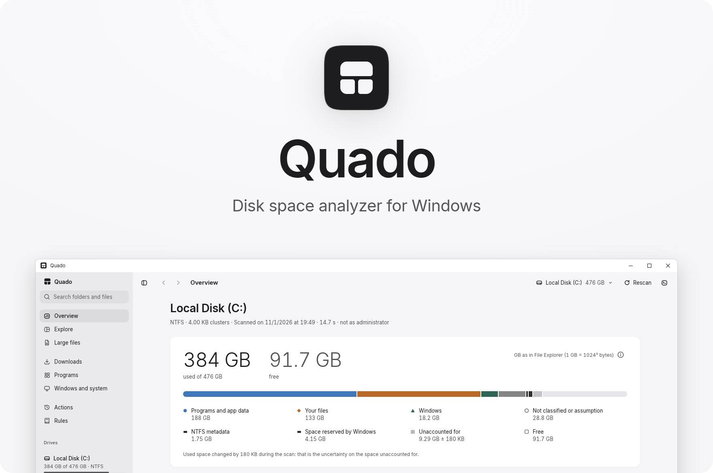
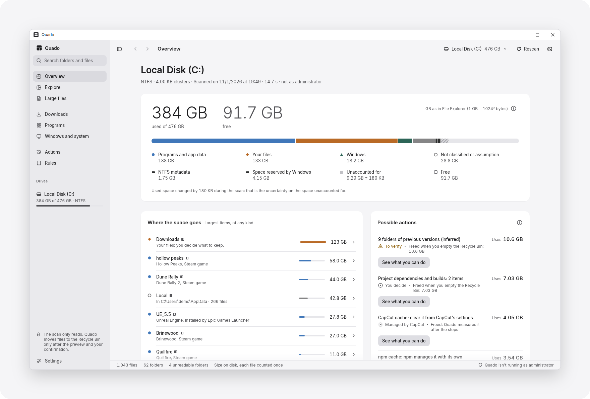
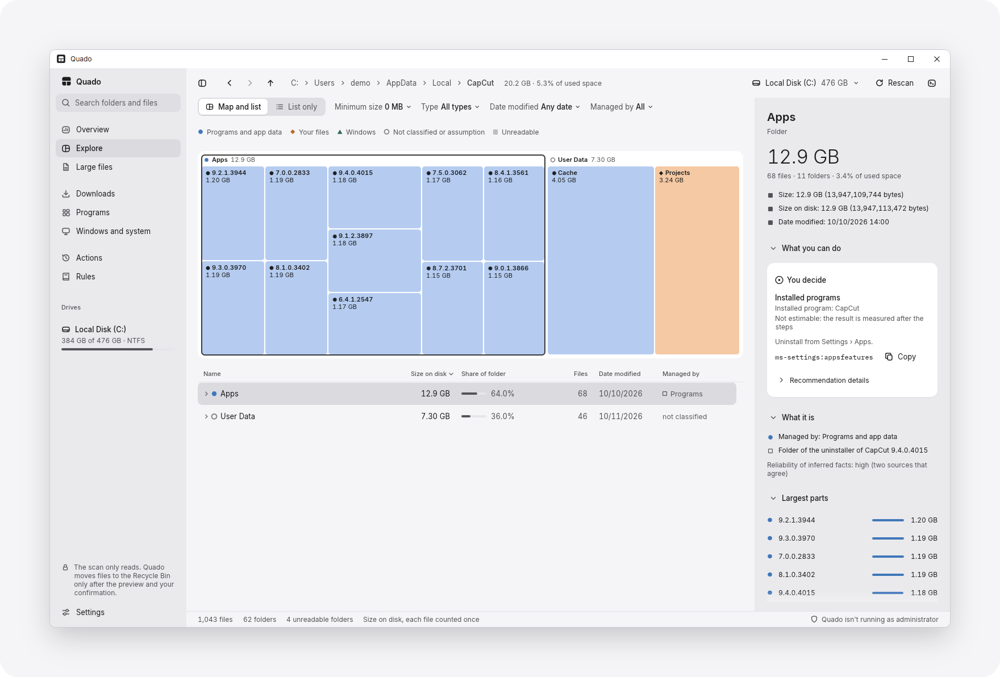

<picture>
  <source media="(prefers-color-scheme: dark)" srcset="docs/images/hero-dark.png">
  <source media="(prefers-color-scheme: light)" srcset="docs/images/hero-light.png">
  
</picture>

<p align="center">
  <a href="https://github.com/Valmairos/quado/releases/latest"></a>
  <a href="https://github.com/Valmairos/quado/actions/workflows/ci.yml"></a>
  <a href="#requisiti"></a>
  <a href="LICENSE"></a>
</p>

<p align="center"><a href="README.md">English</a> · <b>Italiano</b></p>

<p align="center">Quado è un analizzatore dello spazio su disco per Windows. Mostra quali cartelle occupano più spazio in un'unità e, quando può, che cosa sono.</p>

<p align="center"><a href="#funzionalità">Funzionalità</a> · <a href="#requisiti">Requisiti</a> · <a href="#scaricare-quado">Scaricare Quado</a> · <a href="#privacy">Privacy</a> · <a href="#compilare-dal-sorgente">Compilare dal sorgente</a> · <a href="#contribuire">Contribuire</a></p>

## Funzionalità

- Analizza unità NTFS, exFAT e FAT32 senza modificare nessun file.
- Mostra le dimensioni delle cartelle in un elenco e in una mappa, con viste per file grandi, Download, programmi installati, Windows e sistema.
- Riconosce le cartelle create da programmi comuni e da Windows, con regole che citano le loro fonti. Le cartelle che nessuna regola riconosce sono indicate come «Non sappiamo».
- Sposta nel Cestino le cartelle selezionate dopo un'anteprima che controlla file in uso, cartelle sincronizzate e capienza del Cestino.
- Per le altre cartelle rimanda all'impostazione di Windows o al programma che le gestisce, oppure copia il comando ufficiale.
- Su richiesta legge come amministratore le cartelle che la scansione normale non può aprire.
- Non contiene codice di rete.

## Schermate

<picture>
  <source media="(prefers-color-scheme: dark)" srcset="docs/images/overview-dark.png">
  <source media="(prefers-color-scheme: light)" srcset="docs/images/overview-light.png">
  
</picture>

<picture>
  <source media="(prefers-color-scheme: dark)" srcset="docs/images/explore-dark.png">
  <source media="(prefers-color-scheme: light)" srcset="docs/images/explore-light.png">
  
</picture>

Le schermate mostrano Quado in inglese, con dati di prova.

## Requisiti

La tabella seguente separa ciò che è stato provato, su un solo PC, da ciò che dovrebbe funzionare e da ciò che non è supportato.

| | Provato | Dovrebbe funzionare, non provato | Non supportato |
|---|---|---|---|
| Windows | Windows 10 22H2 | Windows 10 da 1809 a 21H2, Windows 11 | Prima di Windows 10 1809, 32 bit, modalità S |
| Altri sistemi | Nessuno | Nessuno | macOS, Linux |
| Processore | x64 | Arm con Windows 11 | Arm con Windows 10 |
| Grafica | Direct3D 12 | WARP, OpenGL | Nessuna |
| File system | NTFS, exFAT, FAT32 | ReFS, Dev Drive | Nessuno |
| Unità | Unità interne, VHDX | Unità USB, schede di memoria, unità di rete connesse | Percorsi di rete senza lettera di unità |
| Lingue | Italiano, inglese | Nessuna | Testo da destra a sinistra |

- La versione minima è dedotta, non provata. `quado.exe` importa `GetDiskSpaceInformationW`, che Windows offre da Windows 10, versione 1809.
- Senza un driver Direct3D 12, Quado usa WARP, il renderer software di Windows, e la finestra risponde lentamente. Se Direct3D 12 non si avvia, Quado usa OpenGL.
- Sui file system diversi da NTFS, exFAT e FAT32 e sulle unità di rete, Quado segna le sue misure «senza garanzie».

## Scaricare Quado

Scaricare `quado.exe` dalla pagina [Releases](https://github.com/Valmairos/quado/releases). Quado è pubblicato solo su quella pagina; una copia presa da un altro sito può contenere codice diverso. Il programma è un unico file eseguibile e funziona senza installazione.

Conservare `quado.exe` in una cartella dedicata, per esempio `%LOCALAPPDATA%\Programs\Quado`. «Ripeti come amministratore» non parte dalla cartella Download né da una cartella temporanea. Per rimuovere Quado, vedere [Disinstallare](#disinstallare).

### Verificare il file

Prima di avviare `quado.exe`, confrontarne lo SHA-256 con quello indicato nelle note di rilascio. In PowerShell:

```powershell
Get-FileHash .\quado.exe
```

### L'avviso di SmartScreen

`quado.exe` non ha una firma del codice. La prima volta che si apre una copia scaricata, Microsoft Defender SmartScreen può bloccarla con l'avviso «Windows ha protetto il tuo PC». L'avviso indica che SmartScreen non riconosce il file, non che vi abbia trovato un malware. Per avviare il file:

1. Selezionare il collegamento sotto il messaggio che mostra i dettagli dell'app.
2. Controllare che l'app sia `quado.exe` e che l'autore sia sconosciuto.
3. Selezionare «Esegui comunque».

Per lo stesso motivo, la richiesta di Windows di «Ripeti come amministratore» indica l'autore come sconosciuto. Per non avviare un eseguibile scaricato, è possibile [compilare Quado dal sorgente](#compilare-dal-sorgente).

## Prima dell'uso

Quado è distribuito senza garanzia, nei limiti consentiti dalla legge. La decisione di spostare un elemento o di eseguire un comando spetta a chi usa Quado, che dovrebbe prima controllare questi punti:

- Le regole sono state verificate su un solo PC. Su un altro PC una regola può riconoscere male una cartella o non essere aggiornata. Prima di confermare, leggere nell'anteprima quale regola si applica.
- Gli elementi spostati restano nel Cestino finché non viene svuotato, a mano o da Sensore memoria. Lo svuotamento li elimina definitivamente, insieme a tutto il resto del Cestino di quell'unità. Prima conviene fare un backup di ciò che potrebbe servire.
- Spostare un elemento da una cartella sincronizzata può eliminarlo anche nel cloud e sugli altri dispositivi. Quado riconosce le cartelle registrate in Windows e quelle di Dropbox, Google Drive per desktop, Syncthing e Resilio Sync. Le cartelle sincronizzate da altri programmi vanno controllate a mano.
- I file che si trovavano solo nel cloud non arrivano nel Cestino del PC. Si recuperano dal cestino del servizio, sul web.
- Prima di eseguire un comando che Quado copia, leggere i rischi che l'ispettore mostra con il comando.
- Su un PC gestito da un'azienda o da una scuola, consultare prima il reparto IT.

## Privacy

Quado non usa la rete. Non ha telemetria, account o controllo degli aggiornamenti e non invia dati. Salva le impostazioni, il registro degli interventi confermati e gli eventuali file di lingua aggiunti in `%APPDATA%\Quado`. [PRIVACY.it.md](PRIVACY.it.md) elenca cosa Quado legge, cosa modifica e salva, e come verificare che non contenga codice di rete.

## Lingue

Quado è disponibile in italiano e in inglese. Al primo avvio usa la prima lingua di visualizzazione di Windows che conosce, altrimenti l'inglese; la lingua si cambia in Impostazioni › Lingua. Per correggere un testo o aggiungere una lingua, vedere [CONTRIBUTING.it.md](CONTRIBUTING.it.md).

## Compilare dal sorgente

Per compilare Quado servono Rust, installato con rustup, e gli strumenti di compilazione C++ di Microsoft. `rust-toolchain.toml` fissa la versione di Rust, che rustup installa la prima volta che si esegue `cargo` nel repository.

```powershell
git clone https://github.com/Valmairos/quado.git
cd quado
cargo build --profile dist
cargo test --workspace
```

L'eseguibile è `target\dist\quado.exe`. Il profilo `dist` usa l'ottimizzazione completa in fase di link; durante lo sviluppo usare `cargo run --release -p quado`. I test segnati come ignorati richiedono i VHDX di prova o una persona davanti al PC. `cargo xtask installa` compila Quado, ne controlla le importazioni e lo copia in `%LOCALAPPDATA%\Programs\Quado`, con un collegamento nel menu Start.

## Disinstallare

Quado non ha un programma di disinstallazione. Per rimuoverlo, eliminare i file e le cartelle seguenti:

- Copia scaricata: `quado.exe` e la cartella `%APPDATA%\Quado`.
- Copia installata con `cargo xtask installa`: la cartella `%LOCALAPPDATA%\Programs\Quado`, il collegamento `%APPDATA%\Microsoft\Windows\Start Menu\Programs\Quado.lnk` e la cartella `%APPDATA%\Quado`.

## Stato del progetto

Quado è alla versione 0.1.0. È stato compilato e usato su un solo PC, un portatile con un processore a 6 core e un SSD NVMe. Su quel PC la scansione completa di circa 3,1 milioni di file dura circa 12 secondi. Il tempo è misurato con i dati delle cartelle già nella cache di Windows. I limiti principali:

- Le regole coprono un insieme limitato di programmi e di parti di Windows. Su altri PC molte cartelle risultano «Non classificato».
- Quado non ha un programma di installazione, una firma del codice né aggiornamenti automatici.
- Un test di usabilità e una sessione completa con la rete scollegata non sono stati svolti.

## Uso dell'AI

Il codice, i documenti e i testi dell'interfaccia di Quado sono stati scritti con Claude Code, l'agente di programmazione sviluppato da Anthropic. Il manutentore, Valmairos, ha stabilito cosa Quado deve fare e cosa non deve fare mai, ha esaminato i risultati e ha richiesto le correzioni. Ha anche eseguito le prove che richiedono una persona davanti al PC, come la lettura dell'unità C: come amministratore.

Quado non contiene AI. Le spiegazioni che mostra provengono dai file delle regole in `crates/quado-kb/regole`.

## Contribuire

Per segnalare un errore o proporre una regola, usare i moduli delle issue su GitHub. Prima di aprire una pull request, leggere [CONTRIBUTING.it.md](CONTRIBUTING.it.md); la struttura del codice è descritta in [docs/ARCHITECTURE.md](docs/ARCHITECTURE.md) (in inglese). I problemi di sicurezza vanno segnalati come indicato in [SECURITY.md](SECURITY.md).

## Licenza

Quado è software libero, distribuito secondo i termini della GNU General Public License, versione 3 o (a scelta) qualsiasi versione successiva. È distribuito senza garanzia, nei limiti consentiti dalla legge: vedere le sezioni 15 e 16 di [LICENSE](LICENSE). I font in `assets/fonts`, Inter e IBM Plex, sono distribuiti con la SIL Open Font License 1.1. La licenza non copre il nome Quado: chi distribuisce una versione modificata deve darle un nome diverso.

Copyright (C) 2026 Valmairos.

## Marchi

Windows, Steam e gli altri nomi di prodotti che compaiono in Quado e nelle sue regole sono marchi dei rispettivi titolari. Quado non è collegato ai titolari né approvato da essi, e usa questi nomi solo per indicarne i prodotti.
