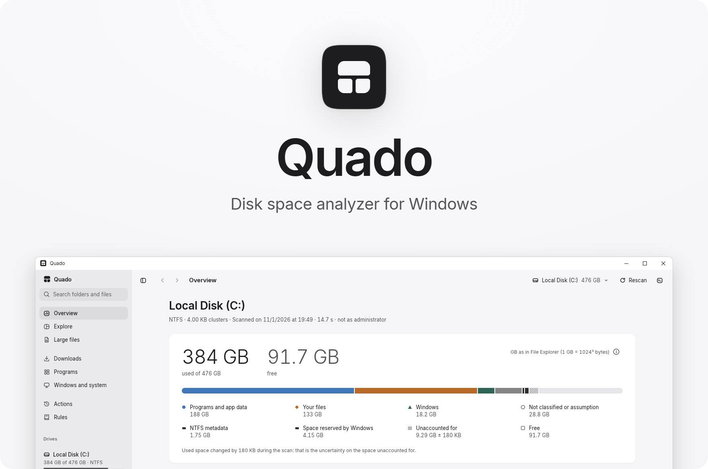
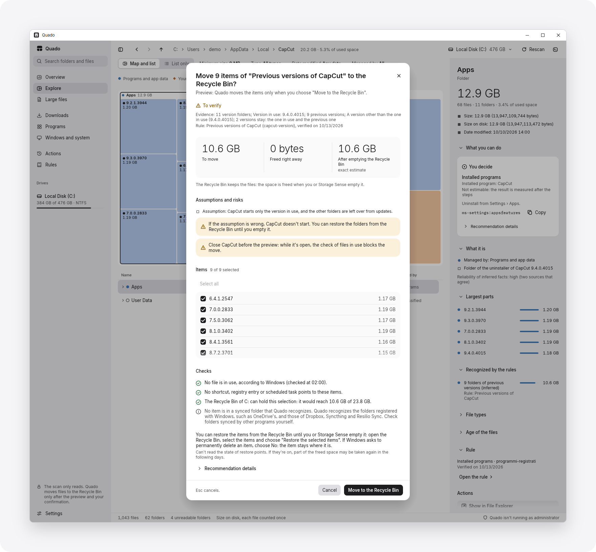
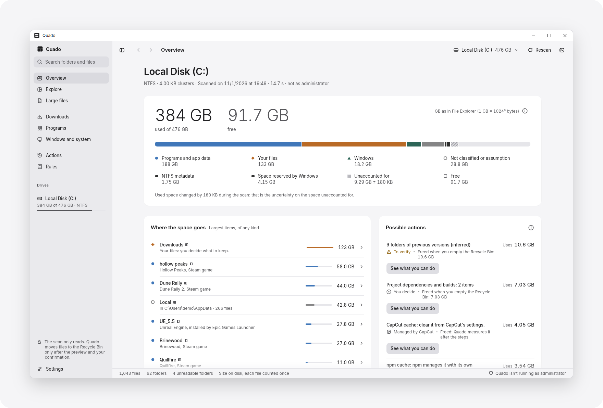
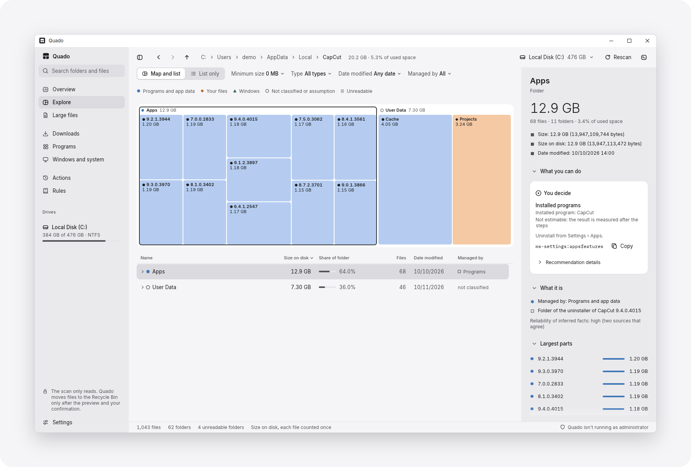

<picture>
  <source media="(prefers-color-scheme: dark)" srcset="docs/images/hero-dark.png">
  <source media="(prefers-color-scheme: light)" srcset="docs/images/hero-light.png">
  
</picture>

<p align="center">
  <a href="https://github.com/Valmairos/quado/actions/workflows/ci.yml"></a>
  <a href="#requirements"></a>
  <a href="LICENSE"></a>
</p>

<p align="center"><b>English</b> · <a href="README.it.md">Italiano</a></p>

<p align="center">Quado is a disk space analyzer for Windows. It shows which folders use the most space on a drive and, where it can, what those folders are.</p>

<p align="center">
  <a href="#features">Features</a> · <a href="#requirements">Requirements</a> · <a href="#download">Download</a> · <a href="#privacy">Privacy</a> · <a href="#build-from-source">Build from source</a> · <a href="#contributing">Contributing</a>
</p>

## Features

- Scans NTFS, exFAT and FAT32 drives. The scan only reads and does not change any file.
- Shows folder sizes as a list and as a map, with separate views for large files, Downloads, installed programs, and Windows and system.
- Identifies folders created by common programs and by Windows through 26 rules. Folders that no rule matches are marked "We don't know".
- Moves selected folders to the Recycle Bin after a preview that checks for files in use, synced folders and Recycle Bin capacity.
- For other folders, points to the Windows setting or the program that manages them, or copies the official command.
- On request, reads as administrator the folders that the normal scan cannot open.
- Contains no network code and sends no data.
- Interface in English and Italian.

### Rules

The rules are in `crates/quado-kb/regole`. Each rule cites a source with a quoted excerpt and the date it was last verified. A rule that has not been verified for twelve months no longer suggests actions. The rules fall into three groups:

| Rules | What Quado does |
|---|---|
| 2 | Offers to move the folders to the Recycle Bin. These rules cover old CapCut versions and project folders such as `node_modules`, `.next` or `target`. |
| 15 | Refers to the program or the Windows setting that manages the space: it shows the steps (for example in Settings › Storage), copies an official command or opens the page for uninstalling a program. After "I've completed the steps", Quado measures the free space again. |
| 9 | Explains what the folder is, without suggesting an action. For parts of Windows such as WinSxS and DriverStore, Quado displays "No steps to follow: don't touch". |

### Moving folders to the Recycle Bin

Two rules can suggest moving folders to the Recycle Bin:

- Build folders of software projects, such as `node_modules`, `.next` or `target`. Quado suggests one only when the matching lockfile is next to it, for example `Cargo.lock` for `target`, because the project can then rebuild the folder. It never suggests a project folder under AppData, ProgramData, Program Files, Windows or `.vscode`.
- Earlier versions that a program keeps after an update. The only program covered is CapCut. Quado keeps the version in use, the one before it and any newer version that an update is installing.

When a rule depends on an assumption that Quado cannot check, its folders are marked "To verify". The move can then start only from the inspector, where the assumption and its risks appear above the button, and "Empty the Recycle Bin…" stays disabled until the user confirms that the program still opens.

For both rules, a preview precedes the move. It estimates the space freed once the Recycle Bin is emptied; until then, the Recycle Bin keeps the files and the free space remains about the same. The preview also checks for files in use, for shortcuts, registry entries or scheduled tasks that point to the folders, for space in the Recycle Bin and for synced folders. Nothing is moved before confirmation.

<picture>
  <source media="(prefers-color-scheme: dark)" srcset="docs/images/move-preview-dark.png">
  <source media="(prefers-color-scheme: light)" srcset="docs/images/move-preview-light.png">
  
</picture>

### Possible actions

In the Overview, the "Possible actions" card shows the space used by each entry. A separate line states when that space is freed: "Freed when you empty the Recycle Bin" or "Freed: Quado measures it after the steps". The hibernation file and the caches of Chrome, Edge and Brave remain outside the card and appear in the inspector and in the Windows and system view.

## Screenshots

<picture>
  <source media="(prefers-color-scheme: dark)" srcset="docs/images/overview-dark.png">
  <source media="(prefers-color-scheme: light)" srcset="docs/images/overview-light.png">
  
</picture>

<picture>
  <source media="(prefers-color-scheme: dark)" srcset="docs/images/explore-dark.png">
  <source media="(prefers-color-scheme: light)" srcset="docs/images/explore-light.png">
  
</picture>

The screenshots show test data.

## Requirements

Quado has been tested on a single PC, running Windows 10 22H2 on an x64 processor.

| | Tested | Should work but not tested | Not supported |
|---|---|---|---|
| Windows | Windows 10 22H2 | Windows 10 1809 to 21H2, Windows 11 | Before Windows 10 1809, 32-bit, S mode |
| Other systems | | | macOS, Linux |
| Processor | x64 | Arm with Windows 11 | Arm with Windows 10 |
| Graphics | Direct3D 12 | WARP, OpenGL | |
| File systems | NTFS, exFAT, FAT32 | ReFS, Dev Drive | |
| Drives | Internal drives, VHDX | USB drives, memory cards, mapped network drives | Network paths without a drive letter |
| Languages | Italian, English | | Right-to-left text |

- The minimum version is inferred, not tested: `quado.exe` imports `GetDiskSpaceInformationW`, which Windows provides from Windows 10, version 1809 (build 17763), so earlier versions cannot start it.
- Before Windows 10, version 2004, Windows does not report the folder of Store apps (`Package.InstalledPath`), and the Programs view shows them as "Location not declared".
- `quado.exe` is an x64 program for 64-bit Intel or AMD processors, so 32-bit Windows cannot run it. Windows 10 on Arm cannot run it either, because it emulates only 32-bit x86 apps. Windows 11 on Arm also emulates x64 apps, but Quado has not been tested there.
- Quado renders with Direct3D 12 on the graphics card that drives the main monitor. The card needs a Direct3D 12 driver with feature level 11_0 or higher. Quado was tested with one integrated and one dedicated card; other cards with such a driver should work.
- Without that driver, Quado uses WARP, the software renderer of Windows, and the window responds slowly (about 230 ms per frame on the first prototype). If Direct3D 12 does not start, Quado uses OpenGL. `quado.exe --renderer warp` and `quado.exe --renderer gl` force either renderer; both were tested only on the first prototype.
- exFAT and FAT32 were tested on virtual disks. These file systems have no hard links, and the size on disk is the size rounded up to the cluster.
- On mapped network drives, and on file systems other than NTFS, exFAT and FAT32, Quado marks its measurements "without guarantees". On ReFS and Dev Drive, files can share clusters (block cloning), so the totals can exceed the space actually used.
- Cloud files were tested with a test sync folder that uses the Windows cloud files API; OneDrive and other apps that use the same API should work. In a cloud folder, Quado shows how much data is in the cloud and how much is on this disk, without downloading files.
- Quado was tested both while not running as administrator and with "Retry as administrator". A standard account should work but has not been tested.
- Arabic and Hebrew names are displayed left to right.

## Download

Download `quado.exe` from the [Releases](https://github.com/Valmairos/quado/releases) page. Quado is published only on that page; a copy obtained from another site may contain different code. The program is a single executable file and runs without installation. The Windows versions on which it has been tested are listed under [Requirements](#requirements).

Store `quado.exe` in a folder of its own, for example `%LOCALAPPDATA%\Programs\Quado`. "Retry as administrator" does not start from the Downloads folder or from a temporary folder, because in those folders a DLL saved next to `quado.exe` could be loaded by the copy of Quado that reads as administrator. In that case, Quado asks for `quado.exe` to be moved and does not open the Windows prompt.

### Verify the file

Before running `quado.exe`, compare its SHA-256 hash with the one in the release notes. In PowerShell:

```powershell
Get-FileHash .\quado.exe
```

### "Windows protected your PC"

`quado.exe` is not code-signed. When a downloaded copy is opened for the first time, Microsoft Defender SmartScreen may block it with the message "Windows protected your PC". The message means that SmartScreen does not recognize the file; it does not report malware. To run the file:

1. Select "More info".
2. Check that the app is `quado.exe` and that the publisher is "Unknown publisher".
3. Select "Run anyway".

Because the file is not signed, "Retry as administrator" also opens a Windows prompt that shows the publisher as unknown.

To avoid running a binary downloaded from the internet, [build Quado from source](#build-from-source). An executable compiled on the local PC is not marked as downloaded, so SmartScreen does not check it.

## Before you use it

Quado is provided without warranty, to the extent permitted by applicable law. The decision to move an item or to run a command remains with the person using Quado, who should check the following points first.

- The rules were verified on a single PC, and on another PC a rule can recognize a folder incorrectly or be out of date. Quado writes "(inferred)" next to the facts it infers, and "To verify" marks a recommendation that rests on an assumption Quado does not check. Before confirming, read in the preview which rule applies and when it was last verified.
- Moved items remain in the Recycle Bin until it is emptied, manually or by Storage Sense. To restore them, open the Recycle Bin, select them and choose "Restore the selected items". Emptying the Recycle Bin deletes them permanently, together with everything else in the Recycle Bin of that drive. Quado keeps no other copy, so back up any data that might still be needed before emptying it.
- Quado recognizes the synced folders registered with Windows, such as those of OneDrive, and those of Dropbox, Syncthing and Resilio Sync. It recognizes Google Drive for desktop only when its location is set in the registry (`DefaultMountPoint`), and never in mirror mode. For a recognized folder, the confirmation states that the move also deletes the item in the cloud or on the other devices that sync it. Check folders synced by other programs manually: moving one of them can delete it on the other devices as well.
- Files that were stored only in the cloud do not reach the Recycle Bin of the PC. They can be recovered from the trash of the service, on the web.
- Before running a command that Quado copies, read the risks and the "Reversibility" line that the inspector shows with it.
- On a PC managed by a company or a school, consult the IT department first. Its policies can forbid unsigned programs, running a program as administrator or deleting certain files.

## Data access and file changes

### Data that Quado reads

The scan reads names, sizes, dates and attributes, and does not require Quado to run as administrator. Windows does not allow the current account to read some folders, such as the profiles of other accounts: their content is counted in the space marked "Unaccounted for", and the Overview lists these folders. "Retry as administrator" reads only those folders and the space used by restore points and shadow copies, after Windows asks for confirmation. It does not read file contents, and for the profiles and Recycle Bins of other accounts it reports totals without names.

To recognize folders and programs, Quado also reads:

- from the registry, the installed programs and the settings of the Recycle Bin, Storage Sense, restore points and power options;
- if Windows tracks app launches, the programs started from Start or File Explorer, with the number of launches and the date of the last one (UserAssist, in the registry);
- the files in which Steam, Epic Games Launcher and CapCut list installed games and versions, the last-played dates of Steam games and the CapCut projects folder;
- the `.npmrc` file in the user profile, of which Quado uses only the folders set for the npm cache and the pnpm store;
- the app packages installed for the current account, such as Microsoft Store apps.

Before a move to the Recycle Bin, the preview asks Windows whether the files are in use, and by which programs. It also checks whether the item is in a synced folder:

- it asks Windows whether the folder is registered as synced, as OneDrive folders are;
- it reads the Dropbox file `info.json`, of which it uses only the folder paths, and the `DefaultMountPoint` registry value of Google Drive for desktop;
- it looks for the markers of Syncthing (`.stfolder`) and Resilio Sync (`.sync`) in the item and in the folders that contain it, reading only their attributes.

For old CapCut versions and project folders, the preview also looks for references to them. It reads the shortcuts in Start and on the desktop, the scheduled tasks, and the registry entries for installed programs, app paths and startup.

Quado reads the content of other files only on request, in the Downloads view:

- "Compare the content" reads files of the same size in full, to find identical copies.
- "Read version data" reads the version information of installers without running them.
- "Read archive indexes" reads the list of files in a zip archive without extracting it.

As with any program that opens a file, these reads can update the last-access date of the file. Files stored only in the cloud are skipped, so they are not downloaded.

### Changes to files

Quado changes files in one way only: it moves them to the Recycle Bin, after the preview and confirmation. It does not delete files: "Empty the Recycle Bin…" opens the Windows dialog, and Windows deletes the items only if the deletion is confirmed there. Quado deletes only its own data, on request in Settings › Data and privacy.

Quado also leaves an item in place when the move could lead Windows to delete files permanently:

- the drive has no Recycle Bin;
- the Recycle Bin is set to delete files immediately;
- the Recycle Bin is too small for the selection, or Quado cannot read its capacity;
- the path of the item, or of a file inside it, is 260 characters or longer.

Quado does not move the Windows folder, System Volume Information or the paging, hibernation and swap files. It also leaves the folders of installed programs in place, with one exception: old CapCut versions.

All other changes go through Windows or the program that installed the files. The uninstall buttons open Settings or Steam. When the official method is a command, such as `pnpm store prune`, Quado displays it and copies it to the clipboard without running it.

## Privacy

Quado does not use the network. It has no update check, telemetry or account, and it sends no data: everything it reads and saves remains on the PC. Updating requires downloading the new release or building Quado again.

Quado saves only the following files, in `%APPDATA%\Quado`:

- `impostazioni.txt`, the settings;
- `interventi.jsonl`, the log of confirmed actions, created with the first action;
- the `lingue` folder, with any added language files and, if created, the template to translate.

Settings › Data and privacy lists these files with their sizes and can delete the action log. The command-line options that measure Quado, and write files elsewhere, exist only in builds with the `misure` feature. The feature is disabled by default, so the executables on the Releases page do not include them.

When Quado opens its window, Direct3D and the graphics driver may write their own caches, such as shader caches in `%LOCALAPPDATA%`. These writes are outside the control of Quado's code.

### Verify the absence of network code

Two checks verify that Quado contains no network code:

- `deny.toml` blocks HTTP and WebSocket client crates such as reqwest, ureq and hyper. Run `cargo deny check` to apply it (requires cargo-deny).
- `cargo xtask importazioni` reads the import table of the executable. It fails if it finds a network library (winhttp, wininet, urlmon, dnsapi, websocket), the connect and name lookup functions of ws2_32, or functions that start a process, such as `CreateProcess`.

The second check also works on a downloaded `quado.exe`:

```
cargo xtask importazioni path\to\quado.exe
```

The import table does not show functions that a program looks up by name at run time, which the Rust standard library does for a few optional Windows functions. To cover that case, a recorded session with the network connected counted zero connections from Quado in 216 samples (risk R19 in `docs/08-analisi-dei-rischi.md`, in Italian).

## Languages

Quado is available in Italian and English. At first start, it uses the first Windows display language that it supports, otherwise English; the language can be changed in Settings › Language.

Interface texts are Fluent files in `crates/quado-ui/lingue`, and rule texts are in `crates/quado-kb/regole`. Italian is the reference language: in `it.ftl`, each key has a comment that states where the text appears. The rules for writing texts and the glossary of fixed terms are in `docs/testi.md` (in Italian).

### Translate without recompiling

A text can be corrected, or a language added, without recompiling:

1. In Settings › Language, select "Create a template to translate". Quado copies the Italian file, comments included, to `%APPDATA%\Quado\lingue` as `modello-da-tradurre.txt`.
2. Rename the file with the language code, for example `fr.ftl`, and translate the values.
3. Select "Reload files".

Keys missing from the file fall back to English, then to Italian.

### Add a language to the build

`cargo xtask lingue nuova fr` creates `crates/quado-ui/lingue/fr.ftl`, and `cargo xtask lingue` lists the missing keys of every language.

## Build from source

Building Quado requires Rust, installed with rustup, and the Microsoft C++ build tools. `rust-toolchain.toml` pins Rust 1.99.0, which rustup installs the first time `cargo` runs in the repository.

```
git clone https://github.com/Valmairos/quado.git
cd quado
cargo build --profile dist
```

The executable is `target\dist\quado.exe`. The `dist` profile uses full link-time optimization, and a build from scratch takes about ten minutes on the development PC. During development, use the release profile: after a change in `quado-ui`, it rebuilt in 52 seconds, compared with 7 minutes 21 seconds for `dist`.

```
cargo run --release -p quado
```

### Run the tests

```
cargo test --workspace
```

Tests marked as ignored do not run by default. Most of them require the VHDX test drives; the others are manual checks on the PC where they run, or they produce measurements and images.

### Install from source

```
cargo xtask installa
```

The command builds with the `dist` profile and checks the imports of the executable (see [Privacy](#privacy)). If the check passes, it copies `quado.exe` to `%LOCALAPPDATA%\Programs\Quado` and adds Quado to the Start menu. All files remain in the user profile, and no administrator prompt appears. Development commands have Italian names: `installa` means install.

### Uninstall

To remove Quado, delete `%LOCALAPPDATA%\Programs\Quado`, the Quado shortcut in the Start menu and `%APPDATA%\Quado`.

## Project status

Quado is at version 0.1.0. It has been built and used on a single PC, a laptop with a 6-core processor and an NVMe SSD (see [Requirements](#requirements)). On that PC, a full scan of a drive with about 3.1 million files takes about 12 seconds, with Quado not running as administrator and the folder data already in the Windows cache. With the whole drive loaded, Quado uses about half a gigabyte of memory. The first scan after a restart has not been measured. Figures and method are in `docs/06-piano-di-test.md` §9 (in Italian).

### Known limitations

- The 26 rules cover a limited set of programs: CapCut, Steam, Epic, the caches of Chrome, Edge and Brave, npm and pnpm, Android emulator images, development projects, and parts of Windows such as WinSxS, Windows.old and the hibernation file. On other PCs, many folders will appear as "Not classified", with the state "We don't know".
- Quado looks for shortcuts, registry entries and scheduled tasks that point to an item only before moving old CapCut versions or project folders. It does not check Windows services, file associations or the PATH.
- Quado has no installer, code signature or automatic updates.
- A usability test and a full session with the network disconnected have not been performed.

## Use of AI

Quado's code, documents and interface texts were written with Claude Code, the coding agent developed by Anthropic. The maintainer, Valmairos, decided what Quado does and what it must never do, reviewed the results and requested changes. The maintainer also ran the tests that require a person at the PC, such as reading drive C: as administrator, which waits for someone to confirm the Windows prompt. Each decision is recorded with its reason in `docs/` (in Italian), together with the measurements cited in this README.

Quado itself contains no AI. The explanations it displays come from the rule files in `crates/quado-kb/regole`, described under [Features](#features).

## Contributing

To report a bug or propose a rule, use the issue forms on GitHub. To translate Quado, see [Languages](#languages). Read [CONTRIBUTING.md](CONTRIBUTING.md) before opening a pull request, and report security vulnerabilities as described in [SECURITY.md](SECURITY.md).

## License

Quado is free software, distributed under the GNU General Public License, version 3 or (at your option) any later version. It is provided without warranty, to the extent permitted by applicable law; see sections 15 and 16 of [LICENSE](LICENSE). Settings › About shows the same notice, the license text and the address of the source code. The fonts in `assets/fonts`, Inter and IBM Plex, are licensed under the SIL Open Font License 1.1.

The license does not cover the name Quado. If you distribute a modified version, give it a different name.

Copyright (C) 2026 Valmairos.

## Trademarks

Windows, OneDrive, Steam, Epic Games, CapCut, Chrome, Brave, Android, npm and the other product names that appear in Quado and its rules are trademarks of their respective owners. Quado is not affiliated with or endorsed by them, and uses these names only to refer to their products.
